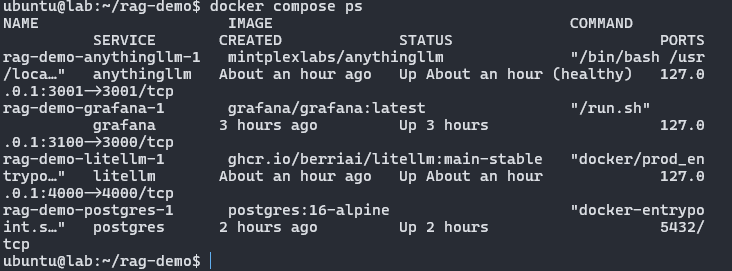
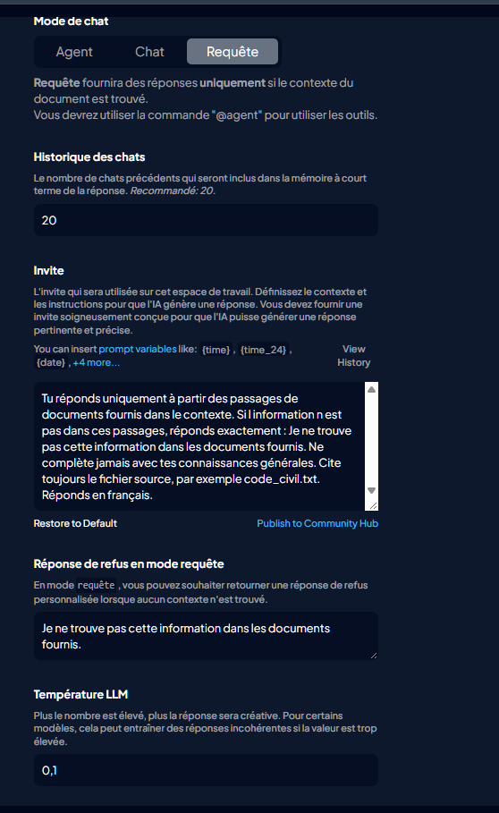
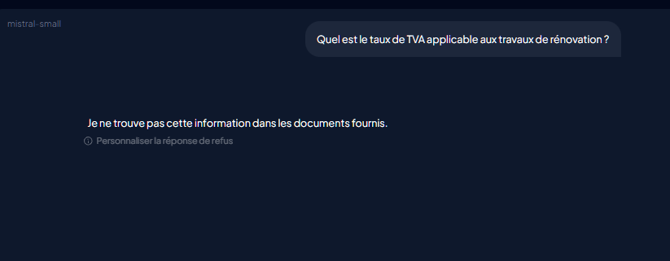
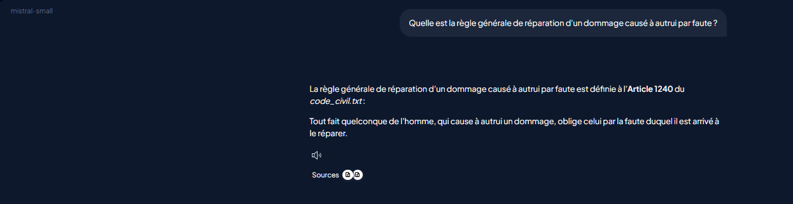
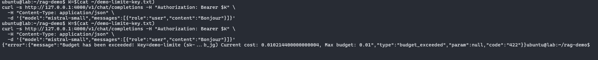
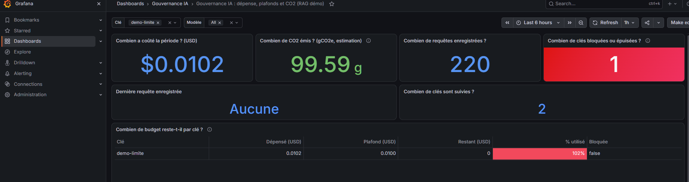
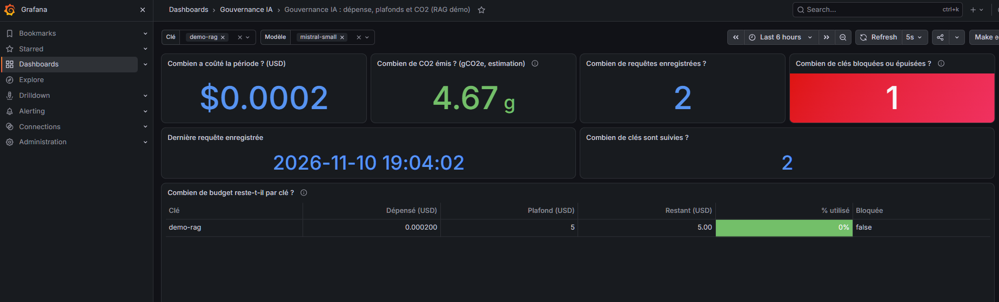
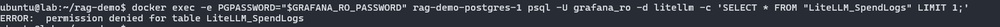

# rag-demo : RAG gouverné (AnythingLLM → LiteLLM → Mistral)

Démo d'un assistant RAG **qui ne répond qu'à partir de ses documents**, avec une **gouvernance mesurable** : budget par clé, consommation de tokens, estimation de CO₂, refus hors corpus et droits de lecture restreints sur la base.

Tout tourne en local sur une VM, derrière `127.0.0.1` : rien n'est exposé sur Internet.

## Sommaire

1. [Architecture](#architecture)
2. [Prérequis](#prérequis)
3. [Installation](#installation)
4. [Configuration d'AnythingLLM](#configuration-danythingllm)
5. [Corpus](#corpus)
6. [Tests : refus hors corpus](#tests--refus-hors-corpus)
7. [Gouvernance](#gouvernance)
8. [Limites](#limites)
9. [Sécurité](#sécurité)

## Architecture

```
Utilisateur ──► AnythingLLM (3001) ──► LiteLLM (4000) ──► Mistral (API)
                 │  RAG : 2 fichiers      │  clés virtuelles, budgets
                 │  (code_civil.txt,      │  journalisation des tokens
                 │   code_travail.txt)    ▼
                 │                    PostgreSQL 16 ◄── Grafana (3100)
                 └── LanceDB + all-MiniLM-L6-v2           lecture seule
                     (embeddings locaux)                  (rôle grafana_ro)
```

- **AnythingLLM** : interface et RAG. Le workspace est en mode **Requête** : sans passage pertinent, il ne répond pas.
- **LiteLLM** : seul point de sortie vers Mistral. Chaque application reçoit une **clé virtuelle** avec un plafond en USD.
- **PostgreSQL** : stocke les clés, les dépenses et les journaux de LiteLLM.
- **Grafana** : dashboard de gouvernance, connecté avec le rôle `grafana_ro`, qui ne voit que les vues `monitoring.*`.

## Prérequis

- Docker et Docker Compose v2
- Une clé API Mistral (console Mistral, avec un plafond mensuel activé)
- Les deux textes de loi copiés depuis [Légifrance](https://www.legifrance.gouv.fr)

## Installation

```bash
git clone https://github.com/epierret/rag-demo.git
cd rag-demo
cp .env.example .env
```

Remplis `.env` : `MISTRAL_API_KEY`, `LITELLM_MASTER_KEY` (commence par `sk-`), `POSTGRES_PASSWORD`, `GRAFANA_ADMIN_PASSWORD`, `GRAFANA_RO_PASSWORD`. **Ne montre jamais ce fichier dans un terminal partagé ni dans une capture.**

Lance la stack :

```bash
docker compose up -d
docker compose ps
```



Crée la clé de démo, plafonnée à 5 USD :

```bash
set -a; source .env; set +a
./scripts/create_key.sh 5
```

Ne copie la clé que dans le champ de configuration d'AnythingLLM, et dans un fichier protégé (`chmod 600`).

Active le monitoring :

```bash
docker compose --profile monitoring up -d grafana
./monitoring/setup_monitoring.sh
```

Le script crée la table `co2_factors`, le rôle `grafana_ro` et les vues `monitoring.v_spend`, `v_keys`, `v_models`.

## Configuration d'AnythingLLM

Paramètres système → **Préférence LLM** :

| Champ | Valeur |
|---|---|
| Fournisseur | Generic OpenAI |
| Base URL | `http://litellm:4000/v1` |
| API Key | clé `demo-rag` |
| Selected Model | `mistral-small` |

Paramètres du workspace **Rag-Test** :

| Réglage | Valeur |
|---|---|
| Mode de chat | Requête |
| Température | 0,1 |
| Seuil de similarité | 0,25 (`Low`) |
| Passages (topN) | 3 |
| Message de refus | « Je ne trouve pas cette information dans les documents fournis. » |
| Invite | voir ci-dessous |

Invite utilisée :

> Tu réponds uniquement à partir des passages de documents fournis dans le contexte. Si l'information n'est pas dans ces passages, réponds exactement : Je ne trouve pas cette information dans les documents fournis. Ne complète jamais avec tes connaissances générales. Cite toujours le fichier source, par exemple code_civil.txt. Réponds en français.



## Corpus

Deux fichiers, copiés **mot pour mot** depuis Légifrance (pas de paraphrase) :

- `code_civil.txt` : articles 1103 et 1240
- `code_travail.txt` : articles L1234-1 et L3121-27

Chaque fichier commence par une ligne de source et la date de consultation. Les noms de fichiers comptent : l'invite demande au modèle de les citer.

## Tests : refus hors corpus

Les questions sont dans [`scripts/questions_test.md`](scripts/questions_test.md). Résultats :

| # | Question | Attendu | Obtenu | Verdict |
|---|---|---|---|---|
| 1 | Réparation d'un dommage par faute | Art. 1240, `code_civil.txt` | Formule officielle, source citée | OK |
| 2 | Force obligatoire des contrats | Art. 1103 | Citation exacte | OK |
| 3 | Durée légale du travail | 35 heures | 35 heures, `code_travail.txt` | OK |
| 4 | Préavis selon l'ancienneté | Les trois cas de L1234-1 | Les trois cas, `code_travail.txt` | OK |
| 5 | Taux de TVA des travaux de rénovation (hors corpus) | Refus exact | Refus exact | OK |
| 6 | Peine de prison pour contrat non exécuté (hors corpus) | Refus exact | Refus exact | OK |

Le refus hors corpus est la capture de référence :





## Gouvernance

### Budget par clé

Chaque clé a un plafond en USD. Quand la dépense atteint le plafond, LiteLLM refuse la requête avec `budget_exceeded`.



Le dashboard montre la clé épuisée :



### Dashboard de gouvernance

Le dashboard « Gouvernance IA » affiche, par clé et par modèle : coût, tokens, requêtes, CO₂ estimé et budget restant.



### Droits de lecture

Grafana se connecte avec `grafana_ro`, qui ne peut lire que les vues `monitoring.*`. La table brute des dépenses, qui contient les identifiants de clés, reste inaccessible :



### Estimation de CO₂

CO₂ estimé = tokens totaux / 1 000 × facteur du modèle (table `monitoring.co2_factors`).

- Facteur de `mistral-small` : 2,85 gCO₂e par 1 000 tokens.
- Ce facteur vient d'une analyse de cycle de vie publiée par Mistral AI, faite sur un modèle plus grand : il est **probablement haut**, pas mesuré.
- Périmètre : inférence seule, hors terminaux.
- La formule compte les tokens d'entrée et de sortie.

**C'est une estimation, pas un bilan carbone.**

## Limites

- **Prix à maintenir** : sans prix dans `litellm/config.yaml`, le coût reste à 0 et aucune clé ne se bloque. Vérifie la grille Mistral avant de publier.
- **Épuisée ≠ bloquée** : le dashboard compte une clé épuisée dès que la dépense atteint le plafond. La colonne « Bloquée » reste à `false` tant que LiteLLM ne la marque pas.
- **Requêtes « sans alias »** : une clé mal configurée dans AnythingLLM fait compter ses requêtes sans alias. Vérifie la ligne `demo-rag` après chaque changement de clé.
- **Corpus minimal** : deux fichiers, quatre articles. Le modèle d'embedding (all-MiniLM-L6-v2) a des scores plus bas qu'un modèle plus gros : le seuil de similarité doit être réglé en conséquence.
- **Mono-utilisateur** : pas de SSO, pas de gestion fine des rôles AnythingLLM.
- **Configuration AnythingLLM non versionnée** : les réglages du workspace sont dans la base, pas dans le dépôt. Les valeurs de référence sont dans ce README.

## Sécurité

- `.env`, `*-key.txt` et les volumes ne doivent jamais être commités : vérifie `.gitignore`.
- Les services sont liés à `127.0.0.1` ; PostgreSQL n'est pas publié sur l'hôte.
- Une clé affichée dans un terminal partagé ou une capture doit être révoquée :

```bash
curl -s http://127.0.0.1:4000/key/delete -H "Authorization: Bearer ${LITELLM_MASTER_KEY}" \
  -H "Content-Type: application/json" -d '{"key_aliases": ["demo-rag"]}'
```

Puis recrée-la avec `./scripts/create_key.sh`.
