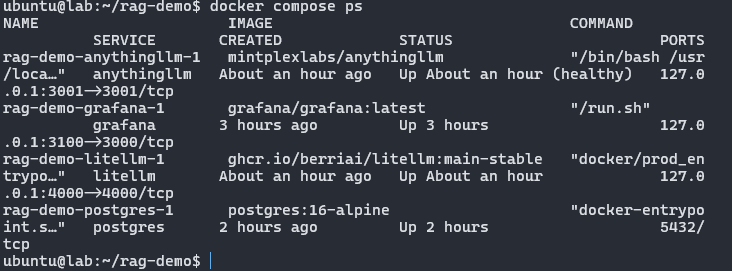
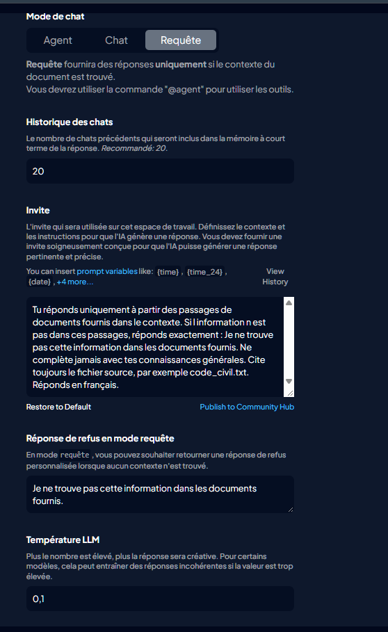
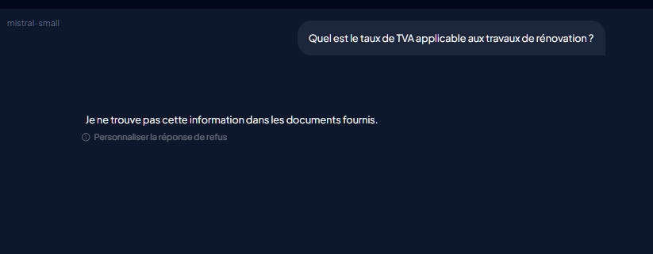
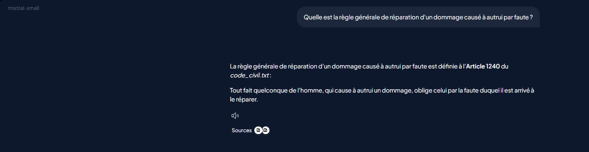
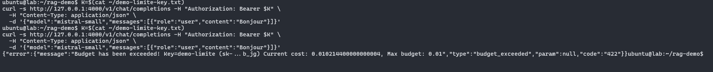
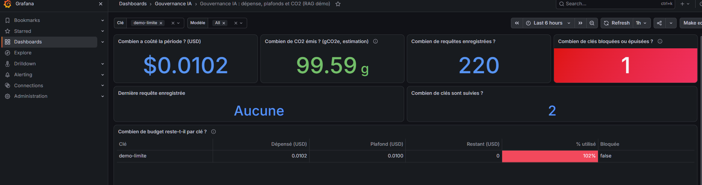
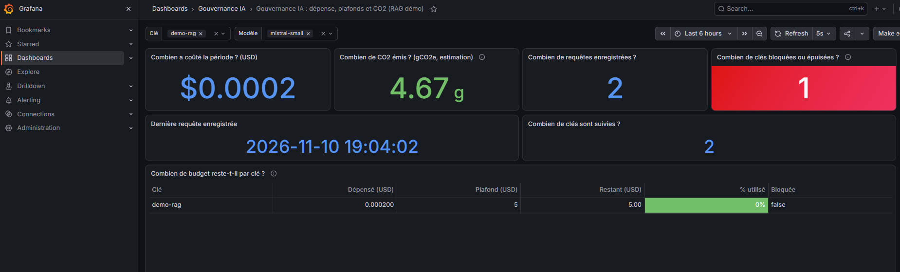
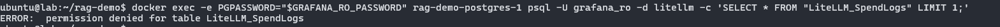

# rag-souverain : RAG gouverné (AnythingLLM → LiteLLM → Mistral)

Démo d'un assistant RAG **qui ne répond qu'à partir de ses documents**, avec une **gouvernance mesurable** : budget par clé, consommation de tokens, estimation de CO₂, refus hors corpus et droits de lecture restreints sur la base.

Tout tourne en local sur une VM, derrière `127.0.0.1` : rien n'est exposé sur Internet.

## Sommaire

1. [Pourquoi ce lab](#pourquoi-ce-lab)
2. [Architecture](#architecture)
3. [Prérequis](#prérequis)
4. [Installation](#installation)
5. [Configuration d'AnythingLLM](#configuration-danythingllm)
6. [Corpus](#corpus)
7. [Tests : refus hors corpus](#tests--refus-hors-corpus)
8. [Gouvernance](#gouvernance)
9. [Limites](#limites)
10. [Sécurité](#sécurité)

## Pourquoi ce lab

Vu le contexte géopolitique et la teneur de certains échanges sur la gouvernance et la souveraineté, je pensais que le sujet finirait par passer devant l'actualité politique. J'imaginais même qu'il deviendrait un thème de campagne.

L'IA s'est démocratisée. Après une phase d'évangélisation, elle est devenue essentielle, au point que très peu de gens s'imaginent aujourd'hui travailler sans elle. Elle n'est là que depuis peu, et pourtant il sera difficile d'évoluer sans. Une fois passé le temps de l'accoutumance aux nouveaux outils, un nouvel espace s'ouvre.

Cet espace touche un domaine voisin : la cybersécurité. L'IA est devenue une porte d'entrée de plus en plus exploitée, et les outils conçus pour produire servent aussi à détruire :

- l'injection de prompt, qui détourne un agent à travers un contenu qu'il lit ;
- l'exfiltration de données par des assistants branchés sur les outils internes ;
- le phishing et les malwares rédigés ou personnalisés à grande échelle par des modèles ;
- l'empoisonnement des modèles, des données d'entraînement ou des dépendances logicielles ;
- le « shadow AI », ces usages non déclarés qui font sortir des données de l'entreprise.

Une gouvernance s'impose donc. Elle soulève la question de la souveraineté, alors que nous dépendons très largement d'acteurs américains. Elle soulève aussi celle de l'économie des tokens, qui fait de chaque requête un coût.

Maintenant que ces sujets sont sur la table, il faut éduquer massivement pour que les infrastructures gagnent en maturité.

C'est dans cet esprit que j'ai construit rag-souverain. Le modèle vient de Mistral AI, un fournisseur français, et les embeddings sont calculés en local. Toutes les requêtes passent par une passerelle unique qui plafonne la dépense de chaque clé, compte les tokens et estime le CO₂. L'assistant refuse de répondre hors de ses documents, et le tableau de bord n'a accès qu'aux données dont il a besoin.

## Architecture

```
Utilisateur ──► AnythingLLM (3001) ──► LiteLLM (4000) ──► Mistral (API)
                 │  RAG : 2 fichiers      │  clés virtuelles, budgets
                 │  (code_civil.txt,      │  journalisation des tokens
                 │   code_travail.txt)    ▼
                 │                    PostgreSQL 16 ◄── Grafana (3100)
                 └── LanceDB + all-MiniLM-L6-v2           lecture seule
                     (embeddings locaux)                  (rôle grafana_ro)
```

- **AnythingLLM** : interface et RAG. Le workspace est en mode **Requête** : sans passage pertinent, il ne répond pas.
- **LiteLLM** : seul point de sortie vers Mistral. Chaque application reçoit une **clé virtuelle** avec un plafond en USD.
- **PostgreSQL** : stocke les clés, les dépenses et les journaux de LiteLLM.
- **Grafana** : dashboard de gouvernance, connecté avec le rôle `grafana_ro`, qui ne voit que les vues `monitoring.*`.

## Prérequis

- Docker et Docker Compose v2
- Une clé API Mistral (console Mistral, avec un plafond mensuel activé)
- Les deux textes de loi copiés depuis [Légifrance](https://www.legifrance.gouv.fr)

## Installation

```bash
git clone https://github.com/epierret/rag-souverain.git
cd rag-souverain
cp .env.example .env
```

Remplis `.env` : `MISTRAL_API_KEY`, `LITELLM_MASTER_KEY` (commence par `sk-`), `POSTGRES_PASSWORD`, `GRAFANA_ADMIN_PASSWORD`, `GRAFANA_RO_PASSWORD`. **Ne montre jamais ce fichier dans un terminal partagé ni dans une capture.**

Lance la stack :

```bash
docker compose up -d
docker compose ps
```



Crée la clé de démo, plafonnée à 5 USD :

```bash
set -a; source .env; set +a
./scripts/create_key.sh 5
```

Ne copie la clé que dans le champ de configuration d'AnythingLLM, et dans un fichier protégé (`chmod 600`).

Active le monitoring :

```bash
docker compose --profile monitoring up -d grafana
./monitoring/setup_monitoring.sh
```

Le script crée la table `co2_factors`, le rôle `grafana_ro` et les vues `monitoring.v_spend`, `v_keys`, `v_models`.

## Configuration d'AnythingLLM

Paramètres système → **Préférence LLM** :

| Champ | Valeur |
|---|---|
| Fournisseur | Generic OpenAI |
| Base URL | `http://litellm:4000/v1` |
| API Key | clé `demo-rag` |
| Selected Model | `mistral-small` |

Paramètres du workspace **Rag-Test** :

| Réglage | Valeur |
|---|---|
| Mode de chat | Requête |
| Température | 0,1 |
| Seuil de similarité | 0,25 (`Low`) |
| Passages (topN) | 3 |
| Message de refus | « Je ne trouve pas cette information dans les documents fournis. » |
| Invite | voir ci-dessous |

Invite utilisée :

> Tu réponds uniquement à partir des passages de documents fournis dans le contexte. Si l'information n'est pas dans ces passages, réponds exactement : Je ne trouve pas cette information dans les documents fournis. Ne complète jamais avec tes connaissances générales. Cite toujours le fichier source, par exemple code_civil.txt. Réponds en français.



## Corpus

Deux fichiers, copiés **mot pour mot** depuis Légifrance (pas de paraphrase) :

- `code_civil.txt` : articles 1103 et 1240
- `code_travail.txt` : articles L1234-1 et L3121-27

Chaque fichier commence par une ligne de source et la date de consultation. Les noms de fichiers comptent : l'invite demande au modèle de les citer.

## Tests : refus hors corpus

Les questions sont dans [`scripts/questions_test.md`](scripts/questions_test.md). Résultats :

| # | Question | Attendu | Obtenu | Verdict |
|---|---|---|---|---|
| 1 | Réparation d'un dommage par faute | Art. 1240, `code_civil.txt` | Formule officielle, source citée | OK |
| 2 | Force obligatoire des contrats | Art. 1103 | Citation exacte | OK |
| 3 | Durée légale du travail | 35 heures | 35 heures, `code_travail.txt` | OK |
| 4 | Préavis selon l'ancienneté | Les trois cas de L1234-1 | Les trois cas, `code_travail.txt` | OK |
| 5 | Taux de TVA des travaux de rénovation (hors corpus) | Refus exact | Refus exact | OK |
| 6 | Peine de prison pour contrat non exécuté (hors corpus) | Refus exact | Refus exact | OK |

Le refus hors corpus est la capture de référence :





## Gouvernance

### Budget par clé

Chaque clé a un plafond en USD. Quand la dépense atteint le plafond, LiteLLM refuse la requête avec `budget_exceeded`.



Le dashboard montre la clé épuisée :



### Dashboard de gouvernance

Le dashboard « Gouvernance IA » affiche, par clé et par modèle : coût, tokens, requêtes, CO₂ estimé et budget restant.



### Droits de lecture

Grafana se connecte avec `grafana_ro`, qui ne peut lire que les vues `monitoring.*`. La table brute des dépenses, qui contient les identifiants de clés, reste inaccessible :



### Estimation de CO₂

CO₂ estimé = tokens totaux / 1 000 × facteur du modèle (table `monitoring.co2_factors`).

- Facteur de `mistral-small` : 2,85 gCO₂e par 1 000 tokens.
- Ce facteur vient d'une analyse de cycle de vie publiée par Mistral AI, faite sur un modèle plus grand : il est **probablement haut**, pas mesuré.
- Périmètre : inférence seule, hors terminaux.
- La formule compte les tokens d'entrée et de sortie.

**C'est une estimation, pas un bilan carbone.**

## Limites

- **Prix à maintenir** : sans prix dans `litellm/config.yaml`, le coût reste à 0 et aucune clé ne se bloque. Vérifie la grille Mistral avant de publier.
- **Épuisée ≠ bloquée** : le dashboard compte une clé épuisée dès que la dépense atteint le plafond. La colonne « Bloquée » reste à `false` tant que LiteLLM ne la marque pas.
- **Requêtes « sans alias »** : une clé mal configurée dans AnythingLLM fait compter ses requêtes sans alias. Vérifie la ligne `demo-rag` après chaque changement de clé.
- **Corpus minimal** : deux fichiers, quatre articles. Le modèle d'embedding (all-MiniLM-L6-v2) a des scores plus bas qu'un modèle plus gros : le seuil de similarité doit être réglé en conséquence.
- **Mono-utilisateur** : pas de SSO, pas de gestion fine des rôles AnythingLLM.
- **Configuration AnythingLLM non versionnée** : les réglages du workspace sont dans la base, pas dans le dépôt. Les valeurs de référence sont dans ce README.

## Sécurité

- `.env`, `*-key.txt` et les volumes ne doivent jamais être commités : vérifie `.gitignore`.
- Les services sont liés à `127.0.0.1` ; PostgreSQL n'est pas publié sur l'hôte.
- Une clé affichée dans un terminal partagé ou une capture doit être révoquée :

```bash
curl -s http://127.0.0.1:4000/key/delete -H "Authorization: Bearer ${LITELLM_MASTER_KEY}" \
  -H "Content-Type: application/json" -d '{"key_aliases": ["demo-rag"]}'
```

Puis recrée-la avec `./scripts/create_key.sh`.
